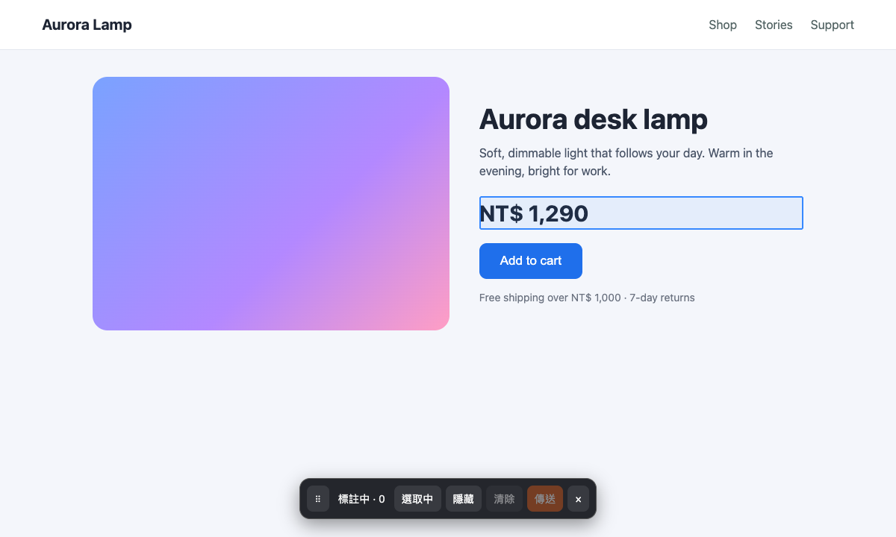
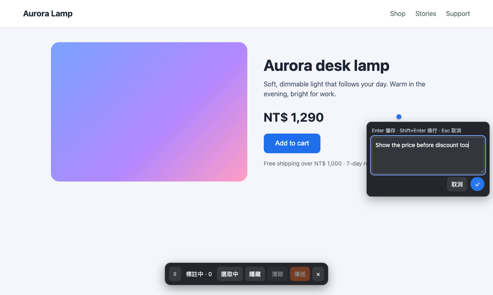
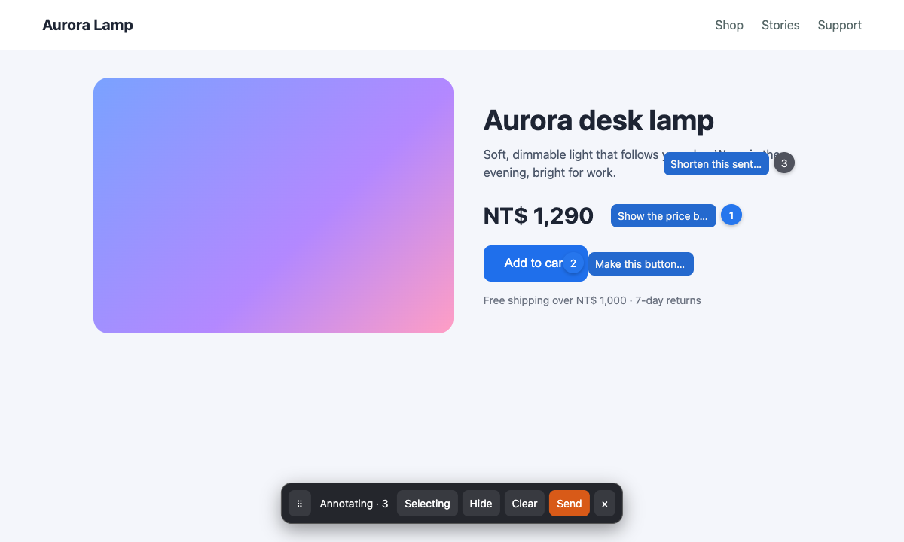
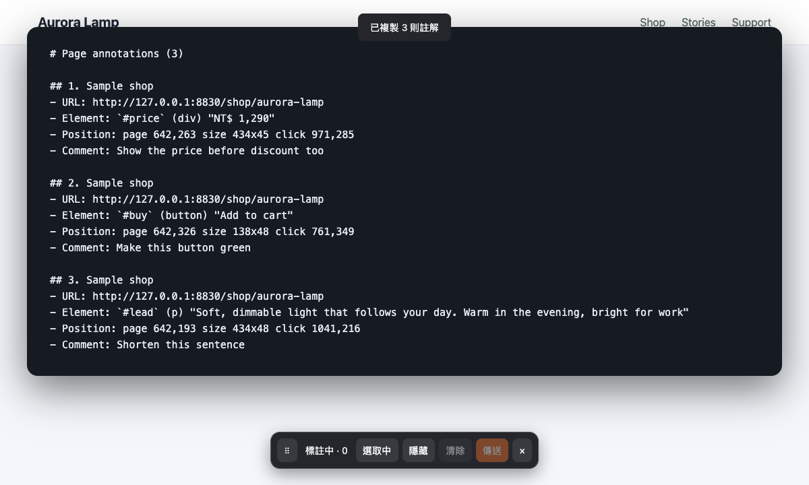

English | [繁體中文](README.zh-TW.md) | [简体中文](README.zh-CN.md)

# Web Labels

A Chrome Manifest V3 extension: select page elements, add notes, and copy them together as Markdown.

## Install

1. On GitHub, click **Code**, then **Download ZIP**, and unzip the archive. Or clone the repository:

   ```sh
   git clone https://github.com/Lotus-030226/web-labels.git
   ```

2. Open `chrome://extensions` in Chrome.
3. Turn on **Developer mode**. Click **Load unpacked**.
4. Select the folder that contains `manifest.json`.
5. Keep that folder in place. Chrome loads the extension from it.
6. Reload open tabs before you annotate them.

Change the shortcut at `chrome://extensions/shortcuts` if another command uses it.

## Usage

1. Click the extension toolbar button or press `Alt+Shift+A`. Point at an element to show its blue outline.

   

2. Click the element, enter a note, and press Enter or ✓ to save it.

   

3. Numbered markers stay at the click point. The toolbar lets you select elements, hide markers, clear notes, and copy notes.

   

4. Click **傳送** (Send) to copy all notes as Markdown. Paste the result into a chat or an issue.

   

The extension buttons currently show Traditional Chinese text:

| Button | Action |
| --- | --- |
| 選取中 / 已暫停 | Pause or resume element selection. Pause selection to interact with the page. |
| 隱藏 / 顯示 | Hide or show markers. |
| 清除 | Click twice to delete all notes. |
| 傳送 | Copy all notes as Markdown. Successful copying clears the copied notes. Failed copying keeps them. |
| × | Close the toolbar and keep the notes. |

Drag the bottom toolbar to move it. Press Shift+Enter for a new line in a note. Press Esc to cancel.
Click a numbered marker to edit or delete its note.

Mode, notes, and numbering return after navigation or reload in the same tab.
Only markers for the current full URL appear. Each tab keeps its own data.
The extension stores data in `chrome.storage.session`.
Data disappears when the browser session ends or you disable or reload the extension.

## Limits

- Chrome blocks content scripts on protected pages, including Chrome system pages and the Chrome Web Store.
- Enable the respective extension access settings to annotate local files and incognito pages.
- The extension cannot select elements inside iframes or website Shadow DOM trees.
- Changes to the page DOM, element IDs, or classes can prevent the extension from finding the original element.
  In that case, a translucent marker shows the saved position.
- The extension excludes input, textarea, and select contents, including when it reads their parent elements. You enter notes yourself.
- The extension handles pointer clicks only. Website capture handlers can receive clicks before the extension does.
- The extension has no screenshots, drawing, voice input, external sending, or cross-browser synchronization.

## License

[MIT](LICENSE). Copyright (c) 2026 Lotus.
